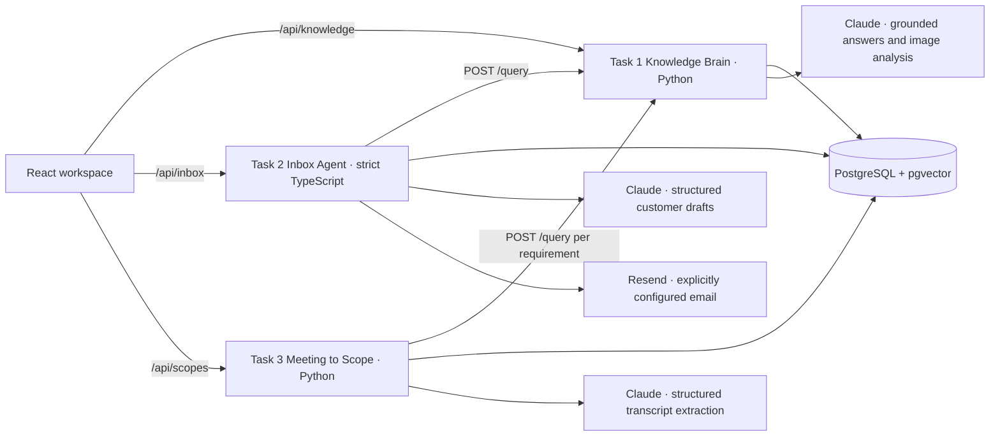

# System design

## Business problem

Customer-facing consultants repeat product-support answers, answer from stale memory, and translate discovery meetings into estimates and promises. The application centralizes documented product knowledge, records citations and human corrections, routes customer email through review controls, and turns meeting passages into a reviewable scope. Product capability claims are only made when Task 1 returns usable evidence. Lack of evidence is an investigation state, not a statement that the feature is impossible.

## Architecture

Task 1 owns the product corpus, document ingestion, embeddings, citations, and approved knowledge. Tasks 2 and 3 call its HTTP contract for every product capability check; they do not import its Python code or access its tables. This creates one update and evidence boundary, and gives both downstream workflows the same abstention and human-escalation behavior. The frontend reaches services through same-origin Vite/Nginx proxies.

The service contract is `GET /health`; `POST /query` with `{question, context?, customer_id?}` and optional `X-Service-Token` / `X-Request-ID`; `POST /ingestion/run` with optional `max_pages`; `GET /ingestion/status`; and admin-protected `GET /escalations`, `POST /escalations`, and `POST /escalations/{id}/resolve`. Query output contains `answer`, `status` (`answered` or `insufficient_evidence`), evidence-backed `sources`, `image_references`, `needs_human`, `escalation_id`, `request_id`, `mode`, and model ID when available. Both HTTP clients validate this behavior and preserve unknown results.

## Task 1: Knowledge Brain

The crawler discovers sitemap URLs recursively, validates HTTPS and the configured source host, checks `robots.txt`, applies retries and bounded rate limits, and rejects redirects. It extracts article headings, ordered text, image alt text and nearby context. A checkpoint makes runs incremental; unchanged content is skipped, removed pages are deactivated, and partial-limit runs do not infer removals. A deliberate CLI, API, or UTC scheduler run starts ingestion; startup never crawls.

Heading-aware chunks have stable content-derived identifiers. PostgreSQL stores articles, chunks, vectors, images, crawl runs/pages, human escalations, approved knowledge and query audit. pgvector HNSW cosine retrieval is combined with lexical overlap. A test/demo SQLite adapter stores JSON vectors and is not intended for production volume. Embedding providers are separately configurable; the local token-hash embedder is explicitly a deterministic test adapter and production rejects it.

The query pipeline removes inactive sources, checks evidence thresholds and contradictions, and only returns source citations belonging to retrieved chunks. The live answer generator uses the official Anthropic Python SDK and a structured tool schema. Its system instructions treat user and corpus content as untrusted. The deterministic demo answer quotes retrieved evidence and is not represented as Claude output. Image metadata is retrieved with cited content; vision analysis uses Claude when configured, limits image size/type/host, and keeps uncertain descriptions pending review. Missing or conflicting evidence creates an escalation. A reviewer can resolve it into versioned global or customer-scoped approved knowledge with evidence and expiry; only the matching authorized customer query sees scoped knowledge.

## Task 2: Inbox Agent

Task 2 uses strict TypeScript, Zod schemas and a typed client for `POST /query`, with a timeout, response validation and explicit errors. Its deterministic classifier routes intent, urgency and risk. Product questions request evidence from Task 1. Refunds, complaints, project requests, commercial quotes, sensitive account questions and urgent messages require human review. When Task 1 is unavailable or returns insufficient evidence, the system writes a safe acknowledgment without product claims.

With live credentials, Claude uses the official TypeScript SDK to create a schema-constrained reply from the email and Task 1 evidence. Citations are restricted to returned source URLs. A demo uses an evidence template, labels the mode, and never claims generation by Claude. A human can edit, approve, reject or escalate; feedback records before/after text, reviewer, reason and state. Resend is optional and simulated by default. External delivery needs a configured provider, recipient and API key; idempotency keys prevent duplicate sends. Failures are recorded and do not qualify toward autonomy.

Autonomy is disabled by default and has a global kill switch. Per subcategory eligibility requires 20 consecutive actual, unchanged, low-risk, nonurgent sends that pass the required safety checks. A substantive edit, rejection, escalation, failure or nonqualifying outcome resets its streak. Demo sends never count. Admin controls require a token in production.

## Task 3: Meeting to Scope

Three explicitly synthetic transcripts exercise search/mobile, checkout/notifications, and a follow-up with additions, removals and changed delivery expectations. Long transcripts are split while retaining line-level speaker/time context. The Claude analyst returns structured requirements with source passages and uncertainty. In demo mode, a conservative rule extractor is used and labelled. Feasibility requests go through Task 1's API; unavailable or insufficient evidence remains unknown. Each requirement gets a stable sequence ID, status, priority, acceptance criteria, dependencies, evidence and estimate state.

Scope, estimates and proposal are assembled from the extracted records. Estimate ranges are transparent rule-based planning ranges (certainty and integration signals), not model-guessed dates or prices. Hours are summed programmatically. The proposal marks exclusions, assumptions, responsibilities, risks and open questions and remains a draft. PostgreSQL JSONB stores transcripts and scope versions in Compose; local demo uses SQLite. A new revision compares against an explicitly supplied human-approved baseline and records changes; draft revisions are not promoted without review. Reviewer and timestamp are recorded when approved.

## Model and database choices

Claude is the production generation model across the service workflows. Exact model IDs are environment-configured because model availability is account-specific and may change. No provider result, price or latency is fabricated. Claude usage tokens and measured latency are recorded; cost is calculated only when matching price-per-million-token configuration is supplied. PostgreSQL/pgvector supports shared durable product retrieval and the inbox/scope service records. SQLite and memory repositories are isolated to local demo/testing.

## Security, reliability and limitations

Credentials are read from environment and `.env` is excluded. Request bodies and images are bounded; external image fetching is host constrained, redirects disabled, and timeout limited. API keys and model prompts stay server-side. Production escalation/approval paths require admin credentials; customer-scoped knowledge requires the Task 1 service token. Emails and meeting transcripts may contain customer data and therefore need appropriate access, retention and database controls before deployment.

Failures have explicit paths: crawler policy/network errors remain resumable; embedding/model errors abstain; malformed model output is rejected; citations are validated; send failures remain reviewable; unknown feasibility is not promoted as fact. Remaining operational limitations are live provider verification, an authorized source crawl, Docker runtime verification, and a higher-level human-reviewed model evaluation. The local environment lacked Docker and provider credentials; see [EVALS.md](EVALS.md).
